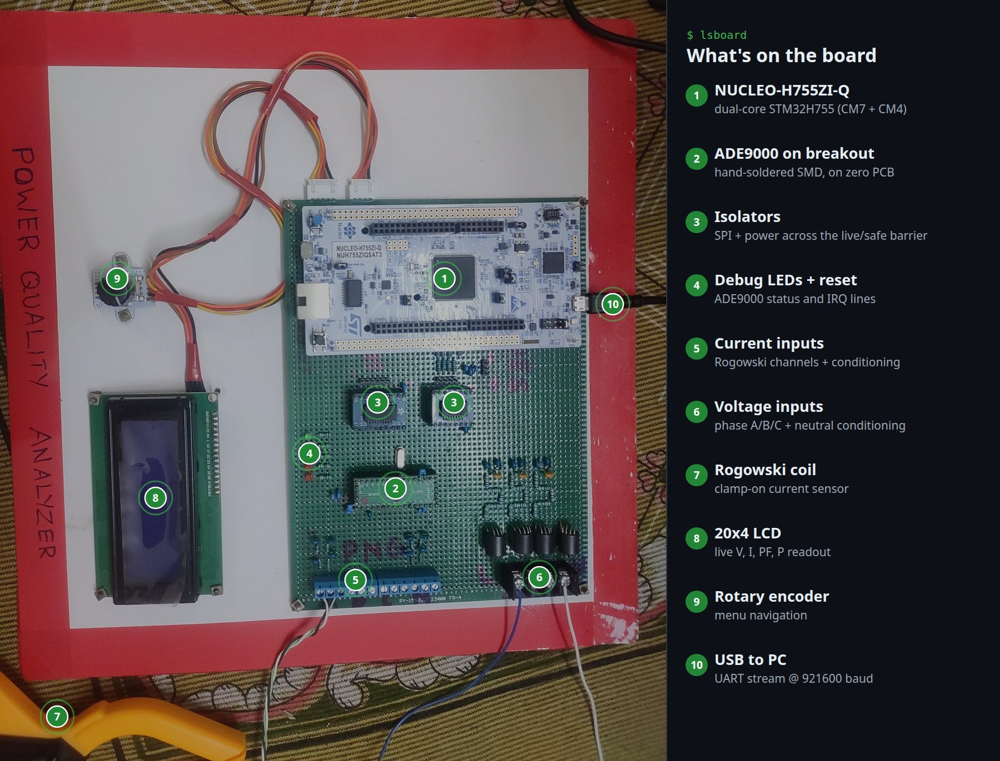
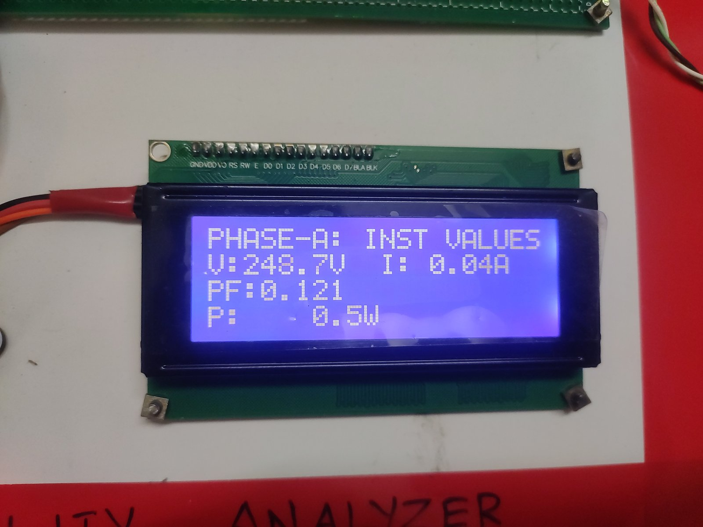
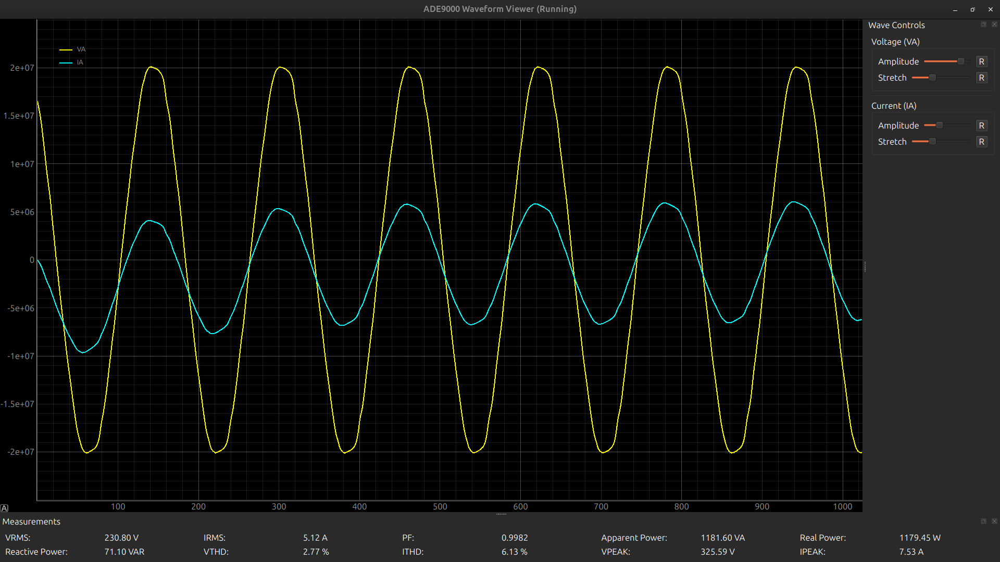
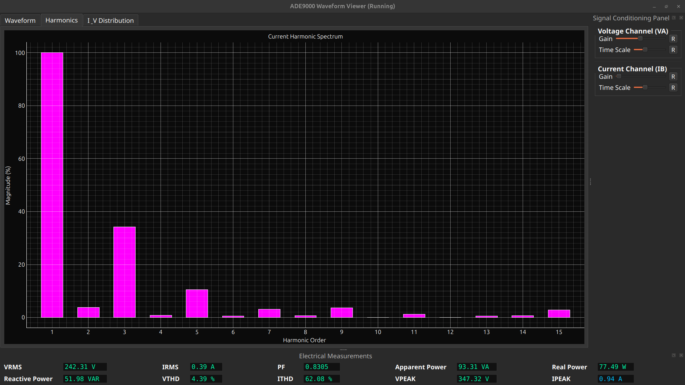
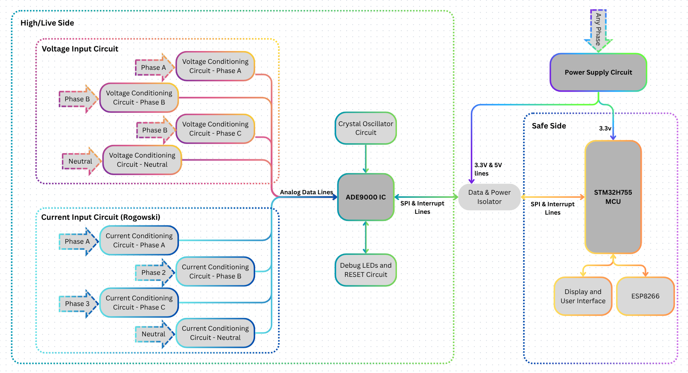
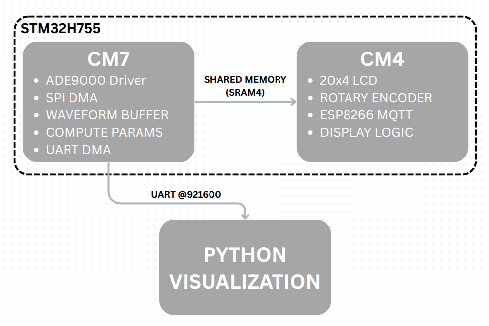

<h1 align="center">DIY Power Quality Analyzer</h1>

<p align="center">
  <b>A hand-built, isolated power quality analyzer: ADE9000 metering IC, dual-core STM32H755, real-time waveform streaming to a Python GUI.</b>
</p>

<p align="center">
  
  
  
  
  
</p>

<p align="center">
  
</p>

No PCB was ordered for this. The ADE9000 is a fine-pitch SMD part, **hand-soldered onto a breakout** and wired up on a **zero PCB (perfboard)** together with the voltage and Rogowski current front ends, the isolation barrier and the debug circuitry. A NUCLEO-H755ZI-Q sits on the safe side and does the digital work.

> [!WARNING]
> **This board connects to mains voltage.** The left half of the block diagram is live. Only work on it de-energised, keep the isolation barrier intact, never connect a grounded USB device to the live side, and use an isolation transformer while testing. This is a learning and reference build, **not** a certified meter.

## Highlights

- **Hand-soldered SMD ADE9000** on a breakout, analog front end built point-to-point on zero PCB
- **Isolated SPI** between the live side (ADE9000) and the safe side (STM32)
- **Dual-core STM32H755**: Cortex-M7 runs acquisition and maths, Cortex-M4 runs the LCD, encoder and Wi-Fi
- **CM7 → CM4 hand-off** through shared, non-cacheable SRAM4 (MPU-configured), with OpenAMP set up on both cores
- **SPI DMA burst reads** of the ADE9000 waveform buffer, triggered by its page-full interrupt
- **CRC16-checked binary stream** of current and voltage samples over UART at **921600 baud**
- **On-device maths** on CM7: RMS, P, Q, S, PF and peaks with calibration and smoothing; THD straight from the ADE9000's own registers
- **20x4 LCD + rotary encoder** with Instant values, Power components, Power quality and Diagnostics pages
- **MQTT over Wi-Fi** through an ESP-01 (ESP8266 AT firmware), publishing all readings once a second
- **Python GUI** with live waveforms, RMS, power, PF, THD, harmonic spectrum and histograms
- Measured on the prototype: about **1% voltage** and **5% current** error

## In action

| 20x4 LCD on the prototype | Live waveforms in the GUI |
|---|---|
|  |  |

<p align="center">
  
</p>

## Hardware architecture

<p align="center">
  
</p>

| Live side | Safe side |
|---|---|
| ADE9000 energy metering IC | STM32H755 (NUCLEO-H755ZI-Q) |
| Voltage conditioning, phases A/B/C + neutral | 20x4 LCD + rotary encoder |
| Rogowski current conditioning, phases A/B/C + neutral | ESP8266 Wi-Fi module |
| Crystal oscillator, debug LEDs, reset | Power supply |

The analog front end follows Analog Devices' **[EVAL-ADE9000-Shield](https://www.analog.com/en/resources/evaluation-hardware-and-software/evaluation-boards-kits/eval-ade9000-shield.html)** reference design. Handy references: the **[UG-1098 user guide](https://www.analog.com/media/en/technical-documentation/user-guides/ade9000-ug-1098.pdf)** and the **[ADE9000 datasheet](https://www.analog.com/media/en/technical-documentation/data-sheets/ade9000.pdf)**.

## Software architecture

<p align="center">
  
</p>

### Data path

```text
ADE9000 waveform buffer ──page-full IRQ──▶ CM7 ──SPI1 DMA burst read──▶ 256 × (IA, VA) samples
CM7 ──CRC16 packet, UART DMA──▶ USART3 @ 921600 baud ──▶ visualizer.py (plots, harmonics)
CM7 ──compute_parameters()──▶ SRAM4 phase_shared.params ──┐
ADE9000 phase registers ──SPI1 DMA──▶ SRAM4 phase_regs ───┴──▶ CM4 ──I2C2──▶ 20x4 LCD
                                                                 CM4 ──USART2──▶ ESP-01 ──MQTT──▶ broker
```

### Wiring (NUCLEO-H755ZI-Q)

| Signal | Pin | Core |
|---|---|---|
| ADE9000 SPI SCK / MISO / MOSI / CS | PA5 / PA6 / PB5 / PD14 | CM7 |
| ADE9000 IRQ0 / DREADY / RESET / PM1 | PB8 / PE11 / PD15 / PG9 | CM7 |
| Waveform stream (ST-LINK VCP) | USART3, PD8 / PD9 | CM7 |
| LCD SDA / SCL (PCF8574 backpack, 0x27) | PB11 / PB10, I2C2 | CM4 |
| Encoder A / B | PB6 / PB7, TIM4 | CM4 |
| Encoder push button | PG14, EXTI | CM4 |
| ESP-01 TX / RX / RST | PD5 / PD6 / PD7, USART2 | CM4 |

### MQTT

Readings go to topic `meter/data` once a second as `#`-separated values:

```text
V#I#PF#S#P#Q#VTHD#ITHD#VPEAK#IPEAK
%.1f#%.2f#%.2f#%.0f#%.0f#%.0f#%.2f#%.2f#%.0f#%.2f   (THD in %)
```

### UART packet

| Field | Type | Size |
|---|---|---|
| Header | `uint16` `0xAA55` | 2 B |
| Frame ID | `uint32` | 4 B |
| Sample count | `uint16` | 2 B |
| IA samples | `int32[256]` | 1024 B |
| VA samples | `int32[256]` | 1024 B |
| CRC16-CCITT | `uint16` | 2 B |
| **Total** | packed, little-endian | **2058 B** |

## Repository layout

```text
.
├── ADE9000_PQA/            STM32CubeIDE dual-core project
│   ├── CM7/                acquisition, compute_parameters(), waveform stream, MPU setup
│   ├── CM4/                LCD pages + menu, encoder, ESP8266 Wi-Fi + MQTT (Drivers/i2c_lcd)
│   ├── Common/Src/         ade9000_drivers/, esp01_drivers/, shared_mem.h, dual-core boot code
│   ├── Middlewares/        OpenAMP
│   └── ADE9000_PQA.ioc     CubeMX configuration
├── visualizer_gui/         Python + PyQt6 real-time GUI
├── docs/                   photos and diagrams
└── tools/                  script that draws the annotated hardware photo
```

## Build and flash

1. Open `ADE9000_PQA` in **STM32CubeIDE** (File → Import → Existing Projects, tick both CM7 and CM4).
2. Create your Wi-Fi config: copy `CM4/Core/Inc/wifi_secrets.example.h` to `wifi_secrets.h` in the same folder and fill in your SSID, password and MQTT broker. `wifi_secrets.h` is git-ignored.
   The encoder timer (TIM4) is initialised in a USER CODE block of the CM4 `main.c`, so CubeMX regeneration keeps it. If CubeMX regenerates `CM4/Core/Inc/stm32h7xx_hal_conf.h`, re-enable `HAL_TIM_MODULE_ENABLED` there.
3. Build **ADE9000_PQA_CM7** and **ADE9000_PQA_CM4**.
4. Flash both cores to the NUCLEO-H755ZI-Q.

## Run the visualizer

```bash
cd visualizer_gui
python3 -m venv .venv && source .venv/bin/activate
pip install -r requirements.txt
python visualizer.py /dev/ttyACM0     # or COM5 on Windows
```

## Status

| Part | State |
|---|---|
| ADE9000 driver, SPI DMA waveform capture, CRC16 UART streaming (CM7) | ✅ |
| On-device RMS, P, Q, S, PF, peaks with calibration (CM7) | ✅ |
| THD from ADE9000 phase registers via SPI DMA | ✅ |
| CM7 → CM4 shared memory (SRAM4) | ✅ |
| 20x4 LCD + rotary encoder UI, 4 pages + menu (CM4) | ✅ |
| ESP8266 Wi-Fi + MQTT publishing (CM4) | ✅ |
| Python visualizer: waveforms, RMS, power, PF, THD, harmonics | ✅ |
| Phases B and C | 🗺️ roadmap |

## Built on

- **[ade9000-stm32h755](https://github.com/js0nnn/ade9000-stm32h755)**: my STM32Cube HAL port of the Analog Devices no-OS ADE9000 driver, used here in `Common/Src/ade9000_drivers`
- The visualizer GUI was rapidly prototyped with ChatGPT's help and then tuned for this stream format

## Third-party code

| Component | Location | License |
|---|---|---|
| STM32H7 HAL, CMSIS | `ADE9000_PQA/Drivers` | see the `LICENSE.txt` files in those folders |
| ADE9000 no-OS driver (Analog Devices) | `ADE9000_PQA/Common/Src/ade9000_drivers` | BSD-style, see file headers |
| OpenAMP / libmetal | `ADE9000_PQA/Middlewares/Third_Party/OpenAMP` | BSD-3-Clause and BSD-2-Clause (SPDX header in each file) |
| I2C_LCD library (DeepBlueMbedded) | `ADE9000_PQA/CM4/Drivers/i2c_lcd` | see file headers |
| nanoprintf | `ADE9000_PQA/CM7/Core/Src/nanoprintf.h`, `CM4/Core/Src/nanoprintf.h` | Unlicense or 0BSD |
